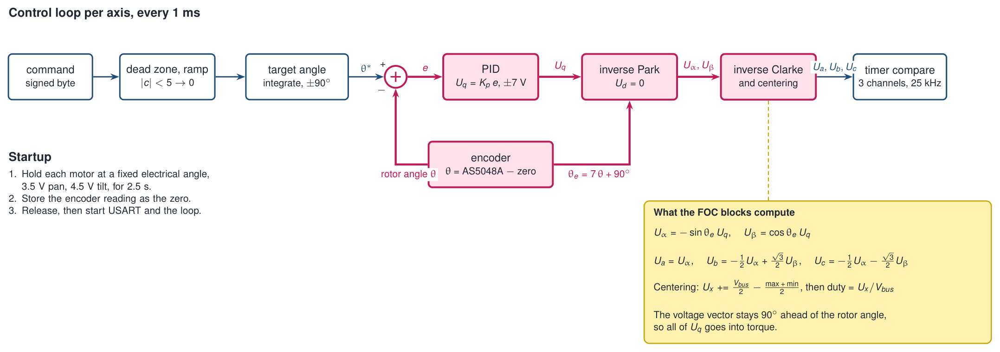

# Tracking Gimbal with FOC Firmware

A two-axis camera gimbal that tracks a person using YOLOv8 on a Raspberry Pi and keeps the face centered in the frame. Two gearless BLDC motors are driven by STM32 firmware with encoder feedback, PID position control, and field-oriented control.

September to December 2025

Software: C (STM32 HAL), Python, YOLOv8, GStreamer  
Hardware: STM32F411, two GM3506 BLDC motors, two DRV8313 drivers, two AS5048A magnetic encoders, Raspberry Pi with camera

## System


The Raspberry Pi only decides where the face is. The STM32 closes the motor loop on its own encoder angle, so a slow or dropped frame on the Pi never leaves the motors without feedback.

## Control loop



## Packet

| Byte | Value |
|---|---|
| 0 | `0xFF` start |
| 1 | x command, signed |
| 2 | y command, signed |
| 3 | `0xFE` end |

Values within a dead zone of ±5 are ignored. If no packet arrives for 2 s, the command is set to zero and the gimbal holds its position.

## Result


Measured from the demo video over 287 frames. When the person stands up, the face reaches an offset of 178 px in the 480 px image. It returns to within 20 px of center 1.5 s later.

## What I built

- System architecture with vision on the Raspberry Pi and motor control on the STM32, connected by USART
- STM32 firmware in C with SPI encoder input, PID position control, and FOC with SVPWM
- Integration of the vision and motor systems and the 3D-printed frame

## Repository

```text
firmware/Core/Src/main.c   control loop, encoder, FOC, USART
firmware/Core/Inc/main.h
firmware/gimbal.ioc        STM32CubeMX configuration
docs/                      figures
```

## Build

Open `firmware/gimbal.ioc` in STM32CubeIDE, generate the code, and replace the generated `main.c` and `main.h` with the files from this repository.

| Signal | Pins |
|---|---|
| Pan motor PWM (TIM1) | PA8, PA9, PA10 |
| Tilt motor PWM (TIM2) | PA0, PA1, PA2 |
| Encoders (SPI1) | PA5 SCK, PA6 MISO, PA7 MOSI, PB0 and PB1 chip select |
| Driver enable | PB12, PB13 |
| USART1 from the Raspberry Pi | PB6 TX, PB7 RX |