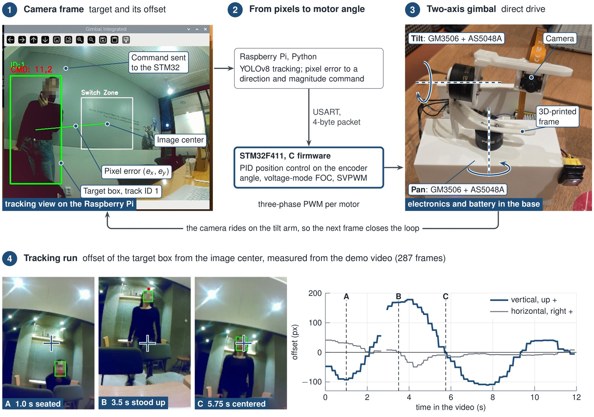
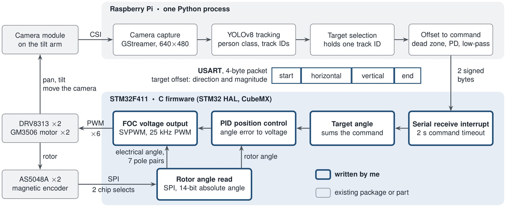
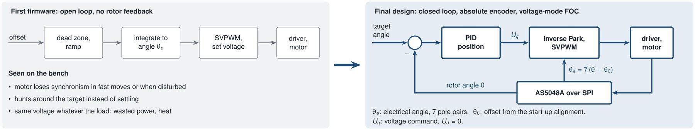

# Tracking Gimbal with FOC Firmware

A two-axis camera gimbal that detects a person with YOLOv8 on a Raspberry Pi and keeps their face centered in the frame. Two gearless BLDC motors are driven by STM32 firmware with SPI encoder feedback, PID position control, and field-oriented control using SVPWM.

September to December 2025

Software: C (STM32 HAL), Python, YOLOv8, GStreamer  
Hardware: STM32F411, two GM3506 BLDC motors, two DRV8313 drivers, two AS5048A magnetic encoders, Raspberry Pi with camera



## System



- The Raspberry Pi tracks the person and sends the target offset from the image center as one signed byte for each axis in a 4-byte packet.
- The STM32 converts the command into a target angle for each axis, reads the rotor angle from the AS5048A encoders, runs a PID position loop, and applies the output as q-axis voltage through inverse Park, inverse Clarke, and SVPWM at 25 kHz.



## What I built

- System architecture with vision on the Raspberry Pi and motor control on the STM32, connected through USART
- STM32 firmware in C for SPI encoder feedback, PID position control, and FOC with SVPWM
- Integration of the vision and motor systems and the 3D-printed frame

## Firmware

`firmware/Core/Src/main.c`

1. Alignment. Each motor is held at a fixed electrical angle for 2.5 s, and the encoder reading is stored as its zero position.
2. Command. A USART interrupt parses `0xFF, x, y, 0xFE`. Values within a dead zone are ignored, and the command is cleared after 2 s without a packet.
3. Target. The command is ramped and integrated into a target angle limited to ±90°.
4. Feedback. The rotor angle is read from the AS5048A over SPI at 14-bit resolution, and the error is wrapped to ±π.
5. Control. The PID output sets the q-axis voltage, limited to 7 V. The electrical angle is the rotor angle multiplied by 7 pole pairs.
6. Output. Inverse Park and inverse Clarke produce the three-phase voltages, which are centered and written to the timer compare registers.

## Result

- The gimbal follows a moving person's face on both axes.
- In the demo video, the face is 178 px off center in a 480 px frame when the person stands up. After 1.5 s, it returns to within 20 px of the center.

## Repository

```
firmware/Core/Src/main.c   control loop, encoder, FOC, USART
firmware/Core/Inc/main.h
firmware/gimbal.ioc        STM32CubeMX configuration (clocks, SPI1, TIM1, TIM2, USART1, pins)
docs/                      figures
```

## Build

Open `firmware/gimbal.ioc` in STM32CubeIDE, generate the code, and replace the generated `main.c` and `main.h` with the files from this repository.

| Signal | Pins |
|---|---|
| Pan motor PWM (TIM1) | PA8, PA9, PA10 |
| Tilt motor PWM (TIM2) | PA0, PA1, PA2 |
| Encoders (SPI1) | PA5 SCK, PA6 MISO, PA7 MOSI, PB0 and PB1 chip select |
| Driver enable | PB12, PB13 |
| USART1 from the Raspberry Pi | PB6 TX, PB7 RX, 115200 baud |