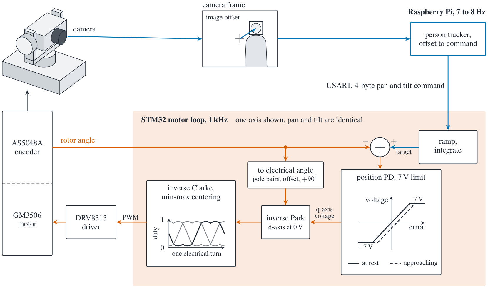
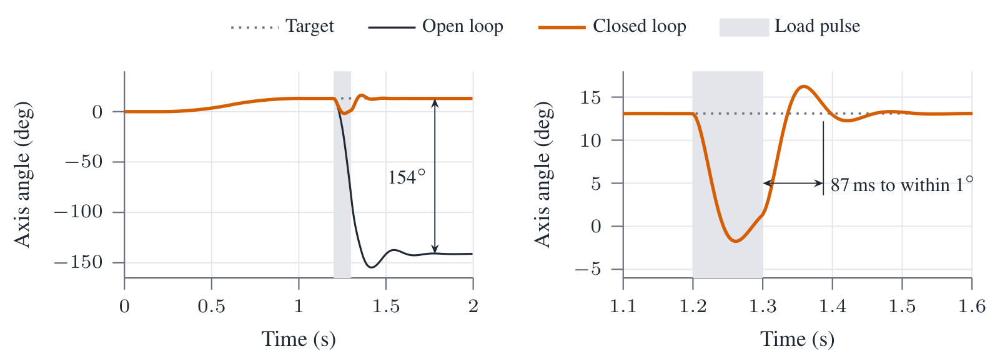
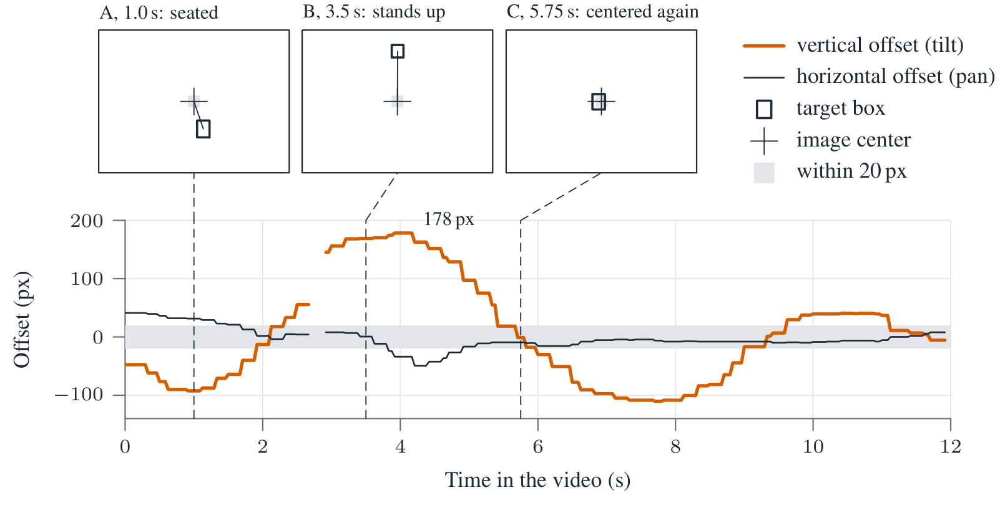

# Tracking Gimbal with FOC Firmware

A two-axis camera gimbal that keeps a tracked person centered in the frame. A Raspberry Pi finds the target with YOLOv8 and sends a direction command. An STM32F411 uses the magnetic encoder in each motor to close the position loop and drives two gearless BLDC motors with field-oriented control.

The project ran from September to December 2025. This repository is a write-up I put together afterward, with cleaned-up STM32 firmware and a small simulation that runs the same control code on a PC.

| Part | |
|---|---|
| Controller | STM32F411 |
| Motors | two GM3506 gimbal motors |
| Drivers | two DRV8313 |
| Encoders | two AS5048A, 14 bit, SPI |
| Vision | Raspberry Pi with camera, YOLOv8, GStreamer at 640 x 480 |

## How it works



Two loops run at different rates. The Raspberry Pi runs the tracker at 7 to 8 frames per second and sends a signed direction-and-magnitude command for each axis. Every 1 ms, the STM32 ramps and integrates the command into a target angle, subtracts the encoder angle, applies the PD position controller, and converts the q-axis voltage into three PWM duties. The figure shows one axis. Pan and tilt run the same loop.

The position loop keeps running between camera frames. If packets stop, the last command stays active until the 2 s timeout, after which the target stops moving.

At power-up, a fixed voltage vector is held for 2.5 s to align each rotor, and the encoder reading is stored as the zero offset. After alignment, the electrical angle is computed from the encoder angle relative to that offset, scaled by the pole-pair count, with a 90 degree shift. The voltage command is applied on the q axis, with the d-axis voltage at zero.

The q-axis voltage comes from a PD controller on the axis angle, limited to 7 V. The proportional term follows the error. The derivative term lowers the voltage while the axis is approaching the target, which is the dashed line in the PD block of the figure. The motors are driven in voltage mode, so the controller output is a voltage command rather than a torque command.

Before the phase voltages become timer compare values, they are shifted so that the highest phase is as far below the upper rail as the lowest phase is above the lower rail. The waveform in the figure is the output of `foc_phase_duties()` over one electrical turn for a q-axis voltage of 6 V.

## Closed loop and open loop in simulation

`sim/sim.c` compiles the firmware's `foc.c` unchanged and runs it against a single-axis motor model. The simulation also runs an open-loop drive that steps the electrical angle without feedback. Both get the same input: a command for 0.4 s, then a load pulse of 0.03 N m for 0.1 s.



Both drives reach the target after the move. The load exceeds the open-loop holding torque, so the rotor slips by three electrical turns, or 154 mechanical degrees, and stays at the new angle because the drive has no rotor-position feedback. The closed loop deviates by 14.9 degrees during the pulse and is back within 1 degree 87 ms after it ends. The peak magnitude of the q-axis voltage is 3.2 V, below the 7 V limit.

The model uses assumed motor parameters (5.57 Ω phase resistance, torque constant 0.068 N m/A, inertia 5e-5 kg m², viscous friction 1e-4 N m s/rad). The gains `Kp = 12 V/rad` and `Kd = 0.1 V s/rad` were chosen in this model.

## Tracking in the demo



This was measured from the video of the final demo, 287 frames at 24 fps, by locating the target box that the tracker draws on its camera view. When the person stands up, the vertical offset peaks at 178 px in the 480 px high image and is back within 20 px of the center 1.5 s later. The traces have a gap of 0.2 s where the box was not found in the video.

## Command packet

| Byte | Value |
|---|---|
| 0 | `0xFF` start |
| 1 | x command, signed |
| 2 | y command, signed |
| 3 | `0xFE` end |

The command gives a direction and a magnitude, not a pixel coordinate, so the Raspberry Pi needs no knowledge of the motor angles. Values inside a dead zone of 5 are ignored. If no packet arrives for 2 s, the command is set to zero and the target stops moving.

## Repository

```text
firmware/Core/Src/foc.c    position controller and FOC output, no hardware access
firmware/Core/Inc/foc.h
firmware/Core/Src/main.c   encoder over SPI, timers, USART packet, alignment, 1 ms loop
firmware/Core/Inc/main.h
firmware/gimbal.ioc        STM32CubeMX configuration
sim/sim.c                  single-axis model, closed loop next to open loop
sim/duties.c               phase duties over one electrical turn
docs/                      figures
```

This repository covers the STM32 side of the gimbal.

## Build

Firmware: open `firmware/gimbal.ioc` in STM32CubeIDE, generate the code, replace the generated `main.c` and `main.h`, and add `foc.c` and `foc.h`.

| Signal | Pins |
|---|---|
| Pan motor PWM (TIM1) | PA8, PA9, PA10 |
| Tilt motor PWM (TIM2) | PA0, PA1, PA2 |
| Encoders (SPI1) | PA5 SCK, PA6 MISO, PA7 MOSI, PB0 and PB1 chip select |
| Driver enable | PB12, PB13 |
| USART1 from the Raspberry Pi | PB6 TX, PB7 RX |

Simulation:

```sh
gcc -O2 -Ifirmware/Core/Inc sim/sim.c firmware/Core/Src/foc.c -lm -o sim
./sim > sim.csv            # optional arguments: kp kd load

gcc -O2 -Ifirmware/Core/Inc sim/duties.c firmware/Core/Src/foc.c -lm -o duties
./duties > duties.csv      # optional argument: voltage
```
