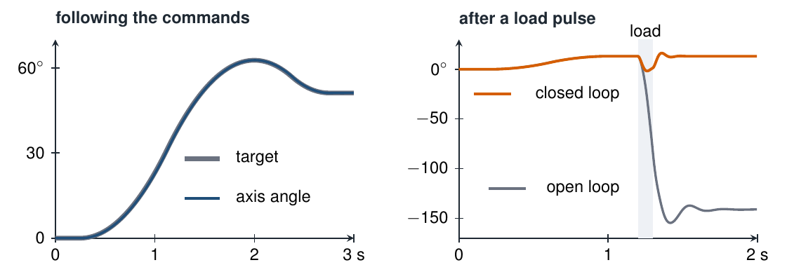

# Tracking Gimbal with FOC Firmware

A two-axis camera gimbal that keeps a person's face in the center of the frame. It needs only power. A Raspberry Pi finds the face, and an STM32 drives two BLDC motors with field-oriented control, using encoder feedback.

## Tracking and motor control on separate processors

Detection time varies from frame to frame, while the motor loop needs a fixed 1 ms period. The Raspberry Pi only tracks, at 7 to 8 frames per second, and sends each axis a signed direction and magnitude over USART. The STM32 only drives. It turns the command into a target angle and runs the position loop, so a slow frame never stretches the motor loop.

## From open loop to closed-loop FOC

The first firmware stepped the electrical angle with no feedback. It lost synchronism in fast moves, hunted around the target and ran hot. Now the encoder angle sets the electrical angle of the rotating frame, and a PD controller on the axis angle sets the q-axis voltage (voltage mode, 7 V limit). At power-up a fixed voltage vector holds each rotor for 2.5 s, and the encoder reading becomes the zero angle. The closed-loop firmware was checked in simulation against a model of one axis. Following the tracker's command stream, updated every 125 ms, the axis stays within 0.4 degrees of the target. After a 0.1 s load pulse it is back within 1 degree in 87 ms, where the open-loop drive slips and does not return.

## Build

Firmware: generate the code from `firmware/gimbal.ioc` in STM32CubeIDE, then use `main.c`, `main.h`, `foc.c` and `foc.h` from this repository.
