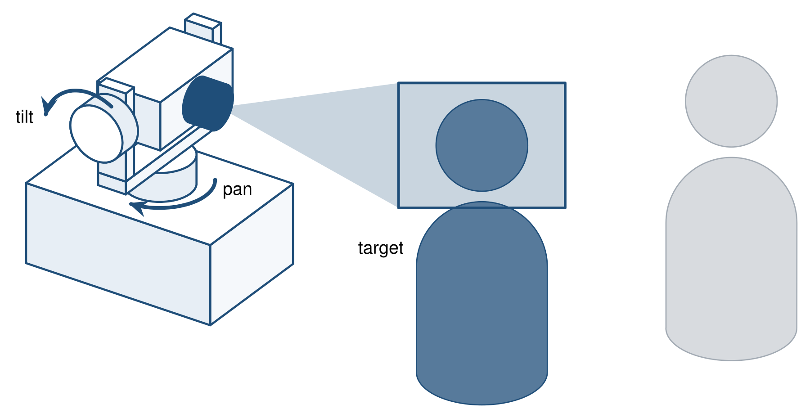
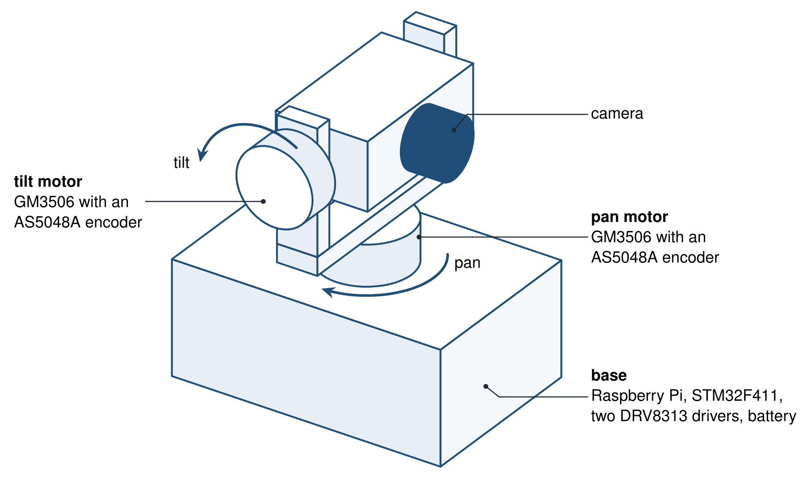
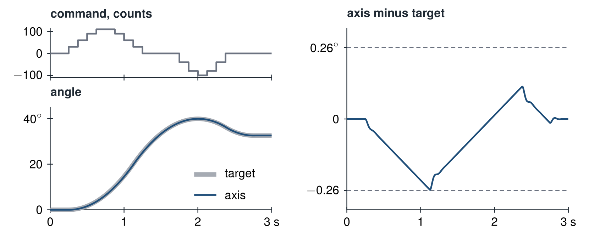
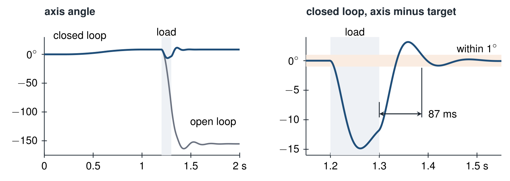

# Tracking Gimbal with FOC Firmware

A two-axis camera gimbal that keeps a person's face in the center of the frame and needs nothing but power: no phone app and no network. A Raspberry Pi finds the person, and an STM32F411 drives the two gimbal motors with voltage-mode field-oriented control (FOC), closed on the angle of an encoder in each motor. Built in the 2025 ELEcourse club project.

In simulation on a model of one axis, the closed-loop firmware keeps the axis within 0.26° of the target angle set by the tracker's commands and is back within 1° of it 87 ms after a load pulse that makes the open-loop drive slip by more than 150°.

**Technical summary**

- **Tracking and motor control on separate processors.** The Raspberry Pi runs the camera, YOLOv8n tracking and target selection at 7 to 8 frames per second and sends a 4-byte command over USART. The STM32 runs both motor loops every 1 ms.
- **Closed-loop voltage-mode FOC.** The encoder angle sets the electrical angle of each motor, and a PD controller on the axis angle sets the q-axis voltage, limited to 7 V and applied with SVPWM.
- **From open loop to closed loop.** The first firmware stepped the electrical angle from the command with a fixed voltage. It lost synchronism in fast moves, hunted around the target and ran hot; the encoder feedback replaces the stepping.
- **Checked on a model of the axis.** The control code in `foc.c` runs unchanged against a motor model in simulation and is compared with the first firmware on the same model.

## Problem and users

Many tracking gimbals depend on a phone app or an internet connection. This gimbal was built to work on its own: the user switches it on and stands in front of the camera, and the camera turns to keep the user's face in the center of the frame. All processing runs on the device, so there is no network delay in the loop and the gimbal can be used anywhere.

When two people are in view, the gimbal keeps following one of them. The target changes only when the other person moves into the center of the frame and stays there.

## Design requirements

- **Standalone.** Power on and track, with the camera, the detector and the motor control on the device.
- **Motor timing independent of vision.** Detection time changes from frame to frame; the motor loop has to keep a fixed 1 ms period regardless.
- **Hold the angle.** Fast moves and disturbances must not make the motors lose synchronism, and each axis must stop at its target without hunting.
- **Stable target.** With two people in view, the target must not flip between them.

## System architecture

Read clockwise from the camera. Dashed boxes run on the Raspberry Pi, navy boxes are the STM32 firmware in this repository, and gray boxes are hardware. The encoder angle (orange) closes the motor loop every 1 ms; the camera rides on the tilt axis, so every new frame closes the tracking loop.

- **Existing, used as they are:** Ultralytics YOLOv8n with its tracking mode, a GStreamer camera pipeline, the STM32 HAL and STM32CubeMX. The FOC and SVPWM steps follow the approach of the SimpleFOC library, rewritten in C on the STM32 HAL.
- **Developed:** the split between the two processors and the USART link, the STM32 firmware in this repository (command parser, ramp and target, PD position loop, FOC with SVPWM, encoder reads, power-up alignment), the 3D-printed frame and the integration. The tracking program on the Raspberry Pi is the team's vision part and is not in this repository.

## Hardware

Both axes are driven directly by GM3506 gimbal motors with no gearbox, so the encoder on each motor reads its axis angle. The pan motor turns the arm that carries the tilt motor, and the tilt motor turns the camera. The encoders are AS5048A magnetic sensors with 14 bits per turn (0.022°), read over SPI in every loop. A GM3506 has eleven pole pairs (24 slots, 22 magnet poles), so one mechanical turn is eleven electrical turns.

The base holds the Raspberry Pi, the STM32F411 board, two DRV8313 three-phase drivers and a battery pack. The Raspberry Pi and the motor drivers are powered separately, so current spikes from the motors do not reach the Raspberry Pi. The frame is 3D-printed; the second print moved the motors to bring the center of mass back onto the axes after the first one vibrated when the motors turned.

## Tracking and motor control on separate processors

Detection time on the Raspberry Pi varies from frame to frame, while the motor loop needs a fixed period. The Raspberry Pi therefore only tracks, at 7 to 8 frames per second, and the STM32 only drives, every 1 ms. A slow frame delays the next command but never stretches the motor loop.

On the Raspberry Pi, a GStreamer pipeline captures 640 × 480 frames with less delay than OpenCV's default backend, and YOLOv8n in tracking mode detects people on 320 × 320 inputs and keeps one ID per person, so a person who is briefly hidden or crosses another keeps the same ID. An earlier version followed the largest person in every frame and switched to anyone who passed in front of the camera. Now the gimbal locks on the largest person, the closest one, and another person becomes the target only after covering 25% more of the central zone than the current target for 0.5 s. The offset of the target from the image center is low-pass filtered and sent as a signed command per axis.

The command travels over USART at 115200 baud in a 4-byte packet. `main.c` parses it byte by byte in the receive interrupt, and the 1 ms loop always uses the latest complete packet.

| Byte | Value | Meaning |
|---|---|---|
| 0 | `0xFF` | Start |
| 1 | `x`, int8 | Pan command, signed counts |
| 2 | `y`, int8 | Tilt command, signed counts |
| 3 | `0xFE` | End; the command is applied only when this byte arrives |

A command is a speed for the axis target, not an angle: one count moves the target by 1.04°/s. Two signed bytes carry the direction and the size of the correction, which keeps the serial traffic small, and the ramp on the STM32 turns the steps between frames into smooth motion at the motor. Commands smaller than 5 counts are treated as zero, and if no complete packet arrives for 2 s, both commands drop to zero and the axes hold their angles. The closed-loop firmware keeps the command interface of the first firmware (the same packet, dead zone, ramp step and angle per count), so a tracker command means the same to both.

## From open loop to closed-loop FOC

The first firmware integrated the ramped command into the electrical angle of the voltage vector and set the voltage from the speed alone: 3 V plus 0.1 V per count while moving (at most 5 V on pan and 4 V on tilt) and 0.5 V at rest. Without feedback it lost synchronism in fast moves, hunted around the target and, with a voltage that ignored the load, ran hot. The closed-loop firmware takes the electrical angle and the voltage from the measured rotor angle instead. `axis_update` in `foc.c` runs for each axis every 1 ms:

1. **Target.** The command passes the dead zone, ramps toward its value by 0.05 counts per millisecond and is integrated into the target angle, limited to ±90°. The ramp and the integration turn the tracker's steps, eight a second, into a smooth target.
2. **Rotor angle.** The 14-bit encoder reading minus the zero found at power-up, wrapped to ±180°.
3. **Position PD.** The angle error goes through a proportional gain of 12 V/rad and a derivative gain of 0.1 V s/rad on the change of the error over one loop period. The integral gain is zero. The output is the q-axis voltage, limited to 7 V, about the largest voltage vector that SVPWM produces linearly from the 12 V supply (12 V / √3 = 6.9 V).
4. **Electrical angle.** Eleven times the rotor angle plus 90°, the direction of the rotor flux. With the d-axis voltage at zero, the voltage vector stands 90° ahead of the rotor, on the q axis.
5. **SVPWM.** `foc_phase_duties` applies the inverse Park and Clarke transforms and centers the three phase voltages between the rails (min-max injection), which gives the same duties as space vector modulation. The duties go to TIM1 (pan) and TIM2 (tilt).

The zero of each axis is set at power-up. `main.c` applies a fixed q-axis voltage (3.5 V on pan, 4.5 V on tilt) at electrical angle zero for 2.5 s. That vector points at 90°, the rotor flux settles there, and the encoder reading at that moment becomes the zero. This is where the 90° in step 4 comes from.

## Results

**On the device.** The gimbal tracked the face of a moving person on both axes, also with a second person in view, with the first firmware.

The closed-loop results below are from simulation. The control code in `foc.c`, unchanged, runs on a PC against a model of one axis: a GM3506 with assumed constants (phase resistance 5.57 Ω, torque and back-EMF constant 0.068 N m/A, inertia 5 × 10⁻⁵ kg m², viscous friction 1 × 10⁻⁴ N m s/rad). The phase duties from `foc_phase_duties` are turned back into a voltage vector, and the model takes 20 steps of 50 µs per 1 ms loop. The first firmware's control law runs on the same model for comparison.

**Following a command stream.** The command changes every 125 ms, the rate of the tracker, rising to 110 counts and back, then falling to −100 counts. The axis stays within 0.26° of the target. The largest error comes where the target moves fastest, at 46°/s.

**After a load pulse.** After a move to 8.3°, a load torque of 0.03 N m is applied to the axis for 0.1 s. The closed loop is pushed 14.9° off its target and is back within 1° of it 87 ms after the load ends. The first firmware, holding with 0.5 V, slips by more than 150° and does not return.

## Repository structure

| Path | Contents |
|---|---|
| `firmware/Core/Src/main.c` | Clock and peripherals, USART packet parser, encoder reads, power-up alignment, the 1 ms loop for both axes |
| `firmware/Core/Src/foc.c`, `firmware/Core/Inc/foc.h` | Ramp and target, PD position loop, electrical angle, inverse Park and Clarke transforms, SVPWM duties |
| `firmware/Core/Inc/main.h` | HAL include and shared declarations |
| `firmware/gimbal.ioc` | STM32CubeMX configuration: pins, timers, SPI, USART |
| `docs/` | Figures |

## Setup and run

Software: STM32CubeIDE with STM32CubeMX 6.15 and the STM32Cube FW_F4 V1.28.3 package.

1. Open `firmware/gimbal.ioc` in STM32CubeIDE and generate the code.
2. Replace `Core/Src/main.c` and `Core/Inc/main.h` with the files in this repository and add `foc.c` and `foc.h`.
3. Build and flash the STM32F411 board.
4. Connect the hardware:

   | Signal | Pins |
   |---|---|
   | Pan driver, TIM1 channels 1 to 3 | PA8, PA9, PA10 |
   | Tilt driver, TIM2 channels 1 to 3 | PA0, PA1, PA2 |
   | Driver enable, pan and tilt | PB12, PB13 |
   | Encoders, SPI1 | PA5 (SCK), PA6 (MISO), PA7 (MOSI) |
   | Encoder chip selects, pan and tilt | PB0, PB1 |
   | Commands, USART1 at 115200 baud | PB6 (TX), PB7 (RX) |

5. Power on with the gimbal free to move. Each axis aligns for 2.5 s and rests for 0.5 s, then the firmware follows the packets `0xFF x y 0xFE` that arrive on USART1.
